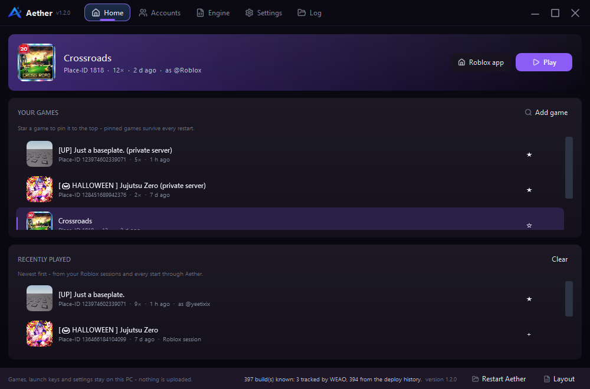
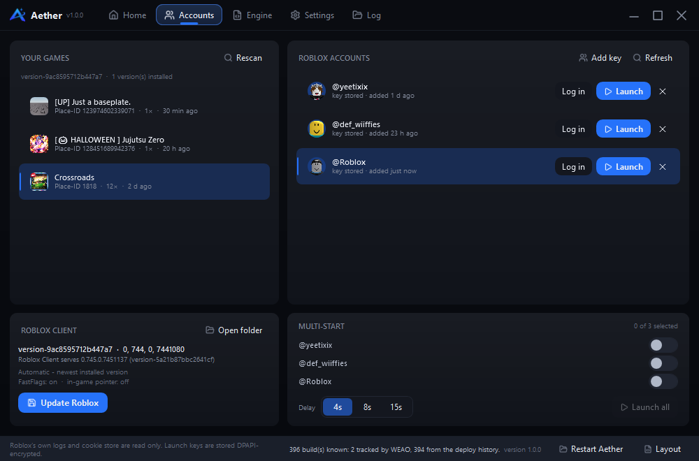
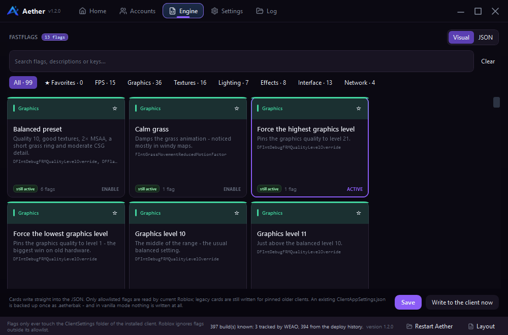
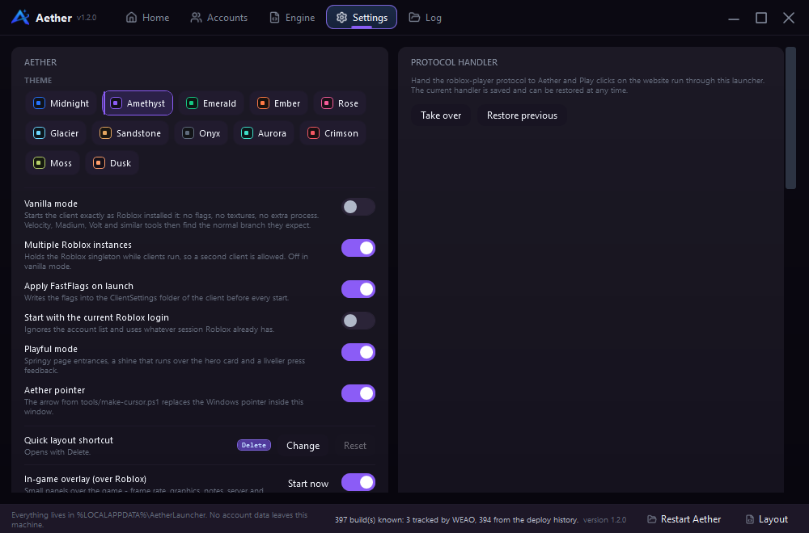
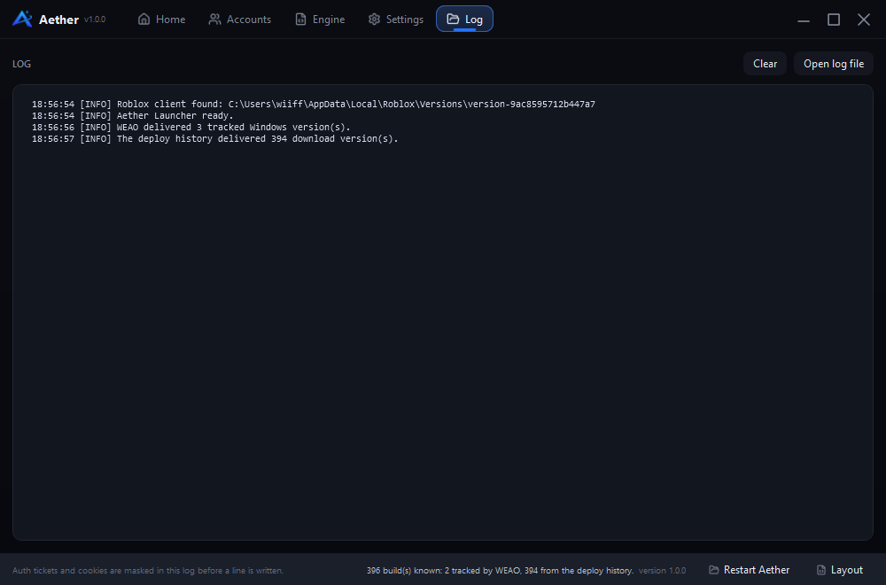
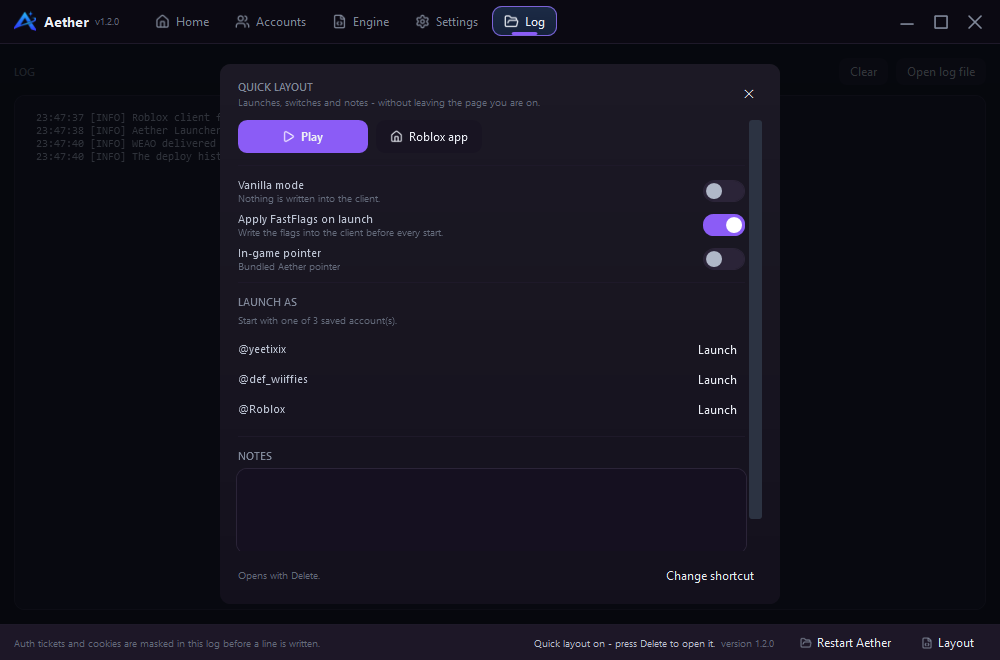
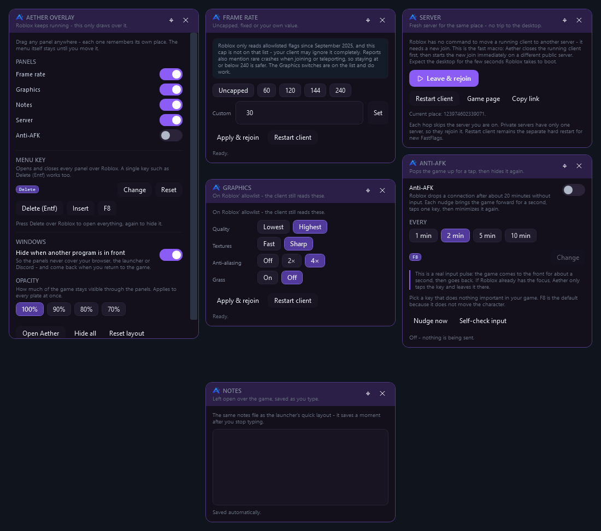
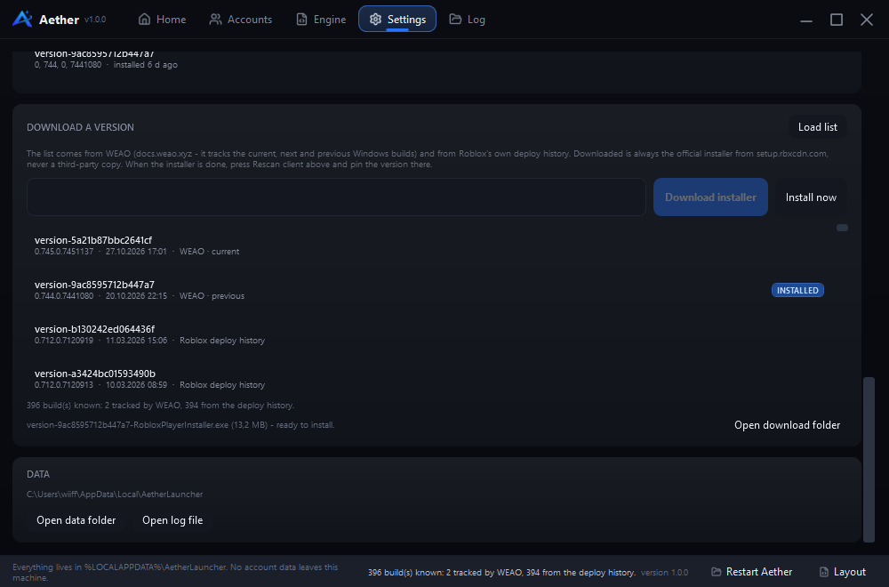

# Aether Launcher

A source-available Roblox launcher for Windows with account management, multiple instances, version pinning, a FastFlags editor, custom fonts, and a custom cursor. It is built with C# / .NET 10 and WPF, without Electron and without an installer. The only NuGet dependency is Microsoft WebView2 for the embedded Roblox sign-in.

The interface follows the Aether Hub design language: the same palette, cards, top navigation, and footer, with the features of a launcher and smooth transitions throughout.


> Aether is source-available, not OSI open source. You may use, modify, and redistribute it for noncommercial purposes. You may not sell it or use it commercially. See [LICENSE](LICENSE).

---

## Features

| Feature | Description |
| --- | --- |
| **Account manager** | Store, verify, and launch any number of accounts. **Sign in with Roblox** opens Roblox's own sign-in page in a temporary browser; Aether never sees the password. Only the cookie is stored, encrypted with AES-256-GCM, with the AES key bound to your Windows user through DPAPI and app-specific entropy. |
| **Launch as account** | The launcher obtains an official auth ticket from `auth.roblox.com` and starts the client with it. No browser account switching. |
| **Version switch** | Select any installed client version, or leave it on **Automatic** for the newest installed build. This lets Aether start the exact client version another tool expects. |
| **Vanilla mode** | The client stays exactly as Roblox installed it: no flags, no textures, no helper process. Tools such as Velocity, Madium, or Volt see the normal branch. |
| **Multiple instances** | Run several Roblox clients at once. A watcher process holds the Roblox singleton while clients are running, even after the launcher closes. |
| **Multi-start** | Start the same place with every enabled account, with a configurable delay between launches. |
| **Game library** | Save places as a place ID, a `roblox.com/games` link, or a private-server link, with names and icons from the Roblox API. |
| **Favorites** | Pin a game to the top of the list. Pinned games stay in `places.json`. |
| **Drag to sort** | Drag a row up or down; the order is stored in `places.json`. |
| **Recently played** | Shows games started through Aether and sessions started by Roblox itself, read from the client logs. Names and icons are filled in through the Roblox API. **Rescan** imports sessions started outside Aether. |
| **FastFlags** | A card view with **99 presets in seven groups** (FPS, Graphics, Lighting, Effects, Textures, Interface, Network) and **153 individual flags**. Search, category chips, and favorites keep the list short. One click applies a preset; a second click removes it. **Visual / JSON** switches the same page to the JSON editor. Existing files are backed up, and every written value is read back and verified. |
| **Allowlist status** | Every card is marked **ALLOWLISTED** when the flag is on Roblox's current allowlist, otherwise **LEGACY**. 49 of the 99 presets are currently allowlisted. Since September 2025 the client only reads allowlisted flags, so the card tells you what can still work. |
| **Start without a game** | With no selected game, **Play** becomes **Open Roblox** and opens the Roblox app with the selected account or the current session. The **Roblox app** button is always available. |
| **Version downloads** | Load the current and historical Roblox versions from WEAO and the official DeployHistory, download the original installer from the Roblox CDN, and install it with progress in the footer. |
| **Immediate FastFlags** | A selected card writes its flags into the JSON editor immediately and removes them when deselected. The JSON view includes Format, Copy, Import, Export, and Clear. |
| **In-game cursor** | Replace the in-game pointer with a custom PNG or the bundled Aether pointer. Original files are kept as `.aetherbak`. |
| **Custom fonts** | Use any installed font or load a `.ttf` / `.otf` for this process only. The system font list is not changed. |
| **Themes** | Twelve palettes (Midnight, Amethyst, Emerald, Ember, Rose, Glacier, Sandstone, Onyx, Aurora, Crimson, Moss, Dusk) switch the entire interface live. The in-game panels follow. |
| **Quick layout** | Press **Delete** to open a card over the current page: play, vanilla mode, flags, in-game pointer, launch as any saved account, and notes that save themselves. The shortcut can be changed in Settings or in the overlay menu. Typing in a text field is never interrupted. |
| **In-game overlay** | The same shortcut over the Roblox window opens six separate panels: Menu, Frame rate, Graphics, Notes, Server, and Anti-AFK. Each panel can be dragged, snaps to screen edges, remembers its own position, and stays out of Alt+Tab, Win+Tab, and the taskbar. Nothing is injected into the client. |
| **Animations** | Smooth page transitions, cards, rows, toggles, and buttons. **Playful mode** adds springy entrances and a sheen over the main card. |
| **Protocol handler** | Optionally take over the `roblox-player` handler so Play clicks on the Roblox website go through Aether. The previous handler is saved and can be restored. |
| **Client maintenance** | Installed version, channel version, and an update button in the account area. |
| **Shortcuts** | `Ctrl`+`1`…`5` pages, `Ctrl`+`Enter` launch, `Delete` quick layout / overlay (configurable), `F5` rescan. |

## Screenshots

| Home | Accounts |
| --- | --- |
|  |  |

| Engine (FastFlags) | Settings | Log |
| --- | --- | --- |
|  |  |  |

| Quick layout (`Delete`) | In-game overlay |
| --- | --- |
|  |  |



The screenshots use sample data and are generated with `--screenshot`; see [Tools](#tools).

## Requirements

- Windows 10 or 11 (x64)
- [.NET SDK 10](https://dotnet.microsoft.com/download) to build
- An installed Roblox client under `%LOCALAPPDATA%\Roblox`

## Quick start

```bash
git clone <your-fork> aether-launcher
cd aether-launcher
dotnet build src/AetherLauncher/AetherLauncher.csproj -c Release
./src/AetherLauncher/bin/Release/net10.0-windows/AetherLauncher.exe
```

Build a single self-contained executable:

```bash
dotnet publish src/AetherLauncher/AetherLauncher.csproj -c Release -r win-x64 --self-contained false -p:PublishSingleFile=true
```

## Usage

### Add an account

The easiest path is **Accounts → Add key → Sign in with Roblox**. It opens Roblox's own sign-in page in a separate window. Sign in with your username and password or passkey; Aether reads only the `.ROBLOSECURITY` cookie from the temporary browser profile. The password is never seen or stored, and the profile is deleted when the window closes.

Without the sign-in window:

1. Sign in at [roblox.com](https://www.roblox.com) in your browser.
2. Open `F12` → **Application** → **Cookies** → `https://www.roblox.com` and copy the value of `.ROBLOSECURITY`.
3. In the launcher, open **Accounts → Add key**, paste the cookie, and choose **Add account**.

In both cases the launcher verifies the key against the Roblox API and shows the username, display name, and avatar. An existing account is updated instead of being added twice. **Log in** next to an account replaces an expired key.

> **Warning:** The `.ROBLOSECURITY` cookie is a full access key to your account. Never share it or post it in screenshots or issues. Aether stores it only as an AES-256-GCM blob; the key itself is protected by Windows DPAPI and bound to your Windows user. The cookie is sent only to `roblox.com`, and the log masks cookies and auth tickets.

### Start a game

On **Home**, enter a place ID, a `roblox.com/games/<id>` URL, or a private-server link and choose **Add game**. Start it from the main card or with **Launch** next to an account. With no account selected, the client uses the current Roblox session.

### Start without a game

With no game selected, **Play** becomes **Open Roblox** and opens the Roblox app with the selected account or the current session. **Roblox app** in the main card does the same at any time. Launch rows in the account list also open the app when no game is selected.

### Choose the starting version

Under **Settings → Roblox client → Starting version**, every installed `version-<hash>` folder is listed. **Automatic** uses the newest installed version. Selecting a version pins it; Aether keeps starting that version even after a newer one arrives.

For tools that expect a specific client build, combine a pinned version with **Vanilla mode**.

> Pinning only works for an installed version. Aether does not download older clients automatically.

### Download a Roblox version

Open **Settings → Download a version** and choose **Load list**:

- **WEAO** (`weao.xyz`) tracks the current, next, and previous Windows versions.
- **Roblox DeployHistory** (`setup.rbxcdn.com/DeployHistory.txt`) lists the official builds with hash, version, and date.

Filter the list, select a row, and choose **Download installer**. Aether downloads the official installer from `setup.rbxcdn.com` with progress in the footer. **Install now** runs it; then choose **Rescan client** and pin the version.

The same official installer is used for every version. If the CDN no longer has files for an old hash, Aether reports that in the log instead of substituting another source.

### Vanilla mode

**Settings → Aether → Vanilla mode** disables everything that touches the client:

| | Normal | Vanilla |
| --- | --- | --- |
| Write FastFlags | yes | no |
| Replace in-game cursor | when enabled | no |
| Multi-instance watcher | yes | no |
| Client files | only the supported files | untouched |

The client starts exactly as Roblox installed it, so tools that attach to the normal client can find the version they support. The trade-off is one client at a time; **Launch all** reports that it is unavailable in Vanilla mode.

### Change the in-game cursor

**Settings → In-game cursor** replaces the client's cursor textures under `content\textures`:

```text
content\textures\ArrowCursor.png
content\textures\ArrowFarCursor.png
content\textures\advCursor-default.png
content\textures\advCursor-white.png
content\textures\MouseLockedCursor.png
content\textures\Cursors\KeyboardMouse\ArrowCursor.png
content\textures\Cursors\KeyboardMouse\ArrowFarCursor.png
content\textures\Cursors\CrossMouseIcon.png
```

- Enable **Replace the pointer in the game** to apply it on the next start.
- **Choose PNG…** loads a custom image; **Use bundled** restores the bundled Aether pointer.
- **Apply now** writes to the installed version immediately; **Restore original** restores the saved files and removes the backups.

Each file keeps its original pixel size and is backed up once as `.aetherbak`. Aether does not touch programs, scripts, or client memory; only these eight image files.

### Change the interface font

**Settings → UI font** lists installed fonts, each shown in its own typeface. **Load font file…** loads a custom `.ttf` / `.otf` into `%LOCALAPPDATA%\AetherLauncher\fonts`. The font is registered for this process only (`AddFontResourceEx` with `FR_PRIVATE`); the system font list is unchanged. The change applies immediately.

### Run multiple clients

Keep **Settings → Multiple Roblox instances** enabled. In **Multi-Start**, enable the accounts, choose the delay (4s / 8s / 15s), and choose **Launch all**. Aether waits between starts so the clients do not race each other.

### FastFlags

The **Engine** page contains **99 cards in seven groups** (FPS, Graphics, Lighting, Effects, Textures, Interface, Network). Each card lists the flags it writes; some set several. Search, category chips, and **★ Favorites** filter the cards. **Visual / JSON** switches between the card grid and the JSON editor.

One click writes the preset's flags into the JSON and saves them; a second click removes them. A value changed by hand is preserved; deselecting only removes values that still match the preset. A card is active when its flags are already fully present.

JSON editor controls:

| Button | Action |
| --- | --- |
| **Format** | Parse and rewrite the JSON with clean indentation. Comments and trailing commas are accepted. |
| **Copy** | Copy the full text to the clipboard. |
| **Import…** | Load an existing `ClientAppSettings.json` into the editor. |
| **Export…** | Write the editor contents to a file. |
| **Clear** | Clear the editor. |
| Search | Filter cards and the editor by name, description, or flag name. |
| **Visual / JSON** | Switch between the card grid and the JSON editor; both use the same JSON. |
| Category chips | **All**, **★ Favorites**, and the seven groups, combinable with search. |

The editor footer reports how many flags are present and how many presets are active, or why the JSON cannot currently be read.

On the next launch, Aether writes the flags to `…\Versions\version-<hash>\ClientSettings\ClientAppSettings.json`. **Write to the client now** reads the file back and reports values that did not arrive. The self-test verifies all 99 presets and 60 distinct flag names this way.

> Roblox only reads flags on its allowlist. Other flags are silently ignored: they do not harm the client, but they do not work either. An existing `ClientAppSettings.json` is backed up once as `.aetherbak`; Vanilla mode writes nothing.

### Protocol handler

Under **Settings → Protocol handler**, Aether can take over the `roblox-player` handler. Play clicks on the Roblox website then go through Aether, so FastFlags and multi-instance support also apply there. **Restore previous** restores the previous command.

### Quick layout

The quick layout is a card over the current page. It is enabled by default and can be opened with the shortcut or with **Layout** in the footer. It contains:

- **Play** or **Roblox app**, exactly as on Home.
- **Vanilla mode**, **Apply FastFlags on launch**, and the **in-game pointer** as switches.
- **Launch as** to open the Roblox app as any saved account.
- **Notes**, saved to `notes.txt` shortly after typing and immediately on close.

`Esc` or a click outside closes it. The same shortcut opens the in-game overlay over Roblox.

To change the shortcut, open **Settings → Quick layout shortcut → Change** and press the new combination (a letter, Tab, or function key together with `Ctrl`, `Alt`, or `Shift`; `Esc` cancels). **Reset** restores `Delete`. The setting is stored in `settings.json` and applies immediately.

### In-game overlay

When Aether starts a client, a small overlay process starts alongside it. The panels start closed and wait for `Delete` (configurable). Each panel can be dragged, lifts while moving, snaps to a screen edge, glides into place, and remembers its own position. Panels are tool windows with an invisible owner window, so they do not appear in Alt+Tab, Win+Tab, or the taskbar. They step back when another program is in front and return when the game is active; this can be disabled in the menu.

| Panel | Action |
| --- | --- |
| **Menu** | Switches for every panel, the menu key, other-program retreat, opacity (100/90/80/70%), **Open Aether**, **Hide all**, and **Reset layout**. The menu itself always stays reachable. |
| **Frame rate** | `Uncapped` (10000), 60, 120, 144, 240, or a custom value from 10 to 10000. Writes `DFIntTaskSchedulerTargetFps`. This flag is **not** on Roblox's allowlist and may be ignored. |
| **Graphics** | Graphics level `Lowest` (1) / `Highest` (21), textures `Fast` (0) / `Sharp` (3), anti-aliasing `Off` / `2×` / `4×`, grass `On` / `Off`. All are allowlisted. Grass `Off` removes the flags instead of writing zero. |
| **Notes** | The same `notes.txt` as the quick layout, with auto-save and a timestamp. |
| **Server** | **Leave & rejoin** leaves the current server and immediately joins another. **Restart client** is the hard restart for new flags. **Game page** opens the place in the browser. **Copy link** copies the game link. |
| **Anti-AFK** | Brings the game window forward for about a second, sends the configured key, and restores the previous window. It verifies that Roblox is in front before sending input. `F8` is the default because it does not move the character. Failed attempts retry after 20 seconds; every attempt is logged. **Nudge now** tests one attempt; **Self-check input** verifies the input path without Roblox. |
| **⌖** | Puts that panel back over the game. |

**Apply & rejoin** on Frame rate and Graphics writes the values, closes the current client, and starts a new join. The desktop is briefly visible while the client starts.

### What a server change can and cannot do

Roblox has no interface for moving a running client to another server. Every change is a new join. Aether reads the place from Roblox's own log, queries the public server list, skips the current server, and asks Roblox for another one. It closes the running client first and then starts the new join; the new client inherits the old window size and position. The desktop is briefly visible. If the start fails, the status line reports it; the old client has already been closed.

**Why the frame rate sometimes does not change:** Roblox only reads allowlisted flags. `DFIntTaskSchedulerTargetFps` is not on that list, so the client may discard it. Aether still writes it for pinned older versions, but the overlay says so honestly. The Graphics switches are allowlisted and work.

The overlay does not read game memory or inject into the client. It draws its own windows over the game and uses supported client settings, a normal client launch, and the launcher. Anti-AFK is the one visible exception and is off by default; it focuses the game window briefly to send a key, then restores the previous window.

To disable the overlay, use **Settings → In-game overlay (over Roblox)**. **Start now** starts the host without a game. The host exits when no client has been running for a while. In Vanilla mode the controls are locked and the overlay explains why.

The panels are normal topmost windows. They are not visible over exclusive fullscreen, but Roblox normally runs in borderless windowed mode. Flags only apply at client start; a running client cannot be changed from outside without touching its process, which Aether does not do.

### Shortcuts

| Shortcut | Action |
| --- | --- |
| `Delete` | Quick layout in the launcher and the in-game overlay over Roblox. Configurable to another key, `Insert`, `F8`, or a combination such as `Ctrl`+`L`. |
| `Ctrl` + `1`…`5` | Home, Accounts, Engine, Settings, Log. |
| `Ctrl` + `Enter` | Start the selected game or open the Roblox app. |
| `Esc` | Close the quick layout or cancel shortcut capture. |
| `F5` | Rescan client, channel, and games. |

## How it works

```text
Browser Play click       ─┐
Launcher (Home/Accounts) ─┤
                          ▼
              Prepare locally:
              · selected client version (pinned or automatic)
              · Vanilla mode: touch nothing
              · write FastFlags to ...\Versions\version-<hash>\ClientSettings\
              · replace cursor textures when enabled
              · start the multi-instance watcher (ROBLOX_singletonMutex)
                          │
                          ▼
       Account selected?  ── yes ──▶ POST auth.roblox.com/v1/authentication-ticket/
                          │            (403 → x-csrf-token → retry → ticket)
                          │            start URI with +gameinfo:<ticket>
                          └─ no  ──▶ roblox://experiences/start?placeId=<id>
                          ▼
              RobloxPlayerBeta.exe "<start URI>"
```

- **Start URI.** The client understands the legacy `roblox-player:` URI. The ticket is in `gameinfo`; the target is URL-encoded in `placelauncherurl`. Without an account, Aether uses the documented deep link so the current Roblox session is used.
- **Auth ticket.** Roblox requires a CSRF exchange: the first `POST` returns `403` with `x-csrf-token`; the second returns the ticket in `rbx-authentication-ticket`.
- **Version selection.** `RobloxInstall.Resolve` searches the known install folders (`%LOCALAPPDATA%\Roblox`, Bloxstrap, Fishstrap, and a custom path). Order: pinned version → registry hint → newest installed. A missing pinned version falls back with a log warning.
- **Multiple instances.** The client checks a named kernel object (`ROBLOX_singletonMutex`, and on some versions `ROBLOX_singletonEvent`). The watcher creates and holds these objects while Roblox is running.
- **Single window.** A second launch (for example through the protocol handler) passes the URI to the running window and exits. **Restart Aether** uses the same mechanism in reverse: the new process waits with `--restart-wait` for the old one to exit.
- **No patching or injection.** Aether does not touch process memory, inject code, or replace program files. It changes only optional, backed-up client settings: `ClientSettings` (FastFlags) and the eight cursor PNGs. Vanilla mode changes neither.

## Project structure

```text
Programm/
├── screenshots/                 Images generated with --screenshot
├── tools/
│   ├── make-cursor.ps1          Build cursor.cur and cursor.png from an image
│   └── build-release.ps1        Single-file release, SHA-256, optional signing
├── README.md
├── LICENSE
└── src/AetherLauncher/
    ├── Assets/                  Icons, logo, cursor, icon license
    ├── App.xaml(.cs)            Startup, fonts, helper modes
    ├── MainWindow.xaml(.cs)     Frameless window, five pages, footer, window hooks
    ├── RobloxLoginWindow.xaml(.cs)  Roblox sign-in in a temporary WebView2 profile
    ├── OverlayHost.cs           Overlay panels, visibility, window state
    ├── OverlayMode.cs           --overlay host process
    ├── Overlay/                 Draggable panel windows and six panels
    ├── Theme.xaml               Palette, templates, styles
    ├── ScreenshotMode.cs        Render every page to PNG
    ├── DownloadMode.cs          --download installer mode
    ├── SelfTest.cs              Core-logic self-test
    ├── UiSelfTest.cs            UI self-test
    ├── Controls/                Animation, smooth scroll, cards, ripple buttons, icons
    ├── Infrastructure/          Observable base, commands, JSON helpers
    ├── Models/                  AccountRecord, PlaceRecord, LauncherSettings
    ├── Services/                Storage, encryption, Roblox API/URI, FastFlags, cursor, fonts, overlay, launch
    └── ViewModels/              MainViewModel and row wrappers
```

## Data locations

| Data | Path |
| --- | --- |
| Accounts (AES-256-GCM encrypted) | `%LOCALAPPDATA%\AetherLauncher\accounts.json` |
| AES key (DPAPI + app entropy) | `%LOCALAPPDATA%\AetherLauncher\vault.key` |
| Games | `%LOCALAPPDATA%\AetherLauncher\places.json` |
| Settings | `%LOCALAPPDATA%\AetherLauncher\settings.json` |
| FastFlags | `%LOCALAPPDATA%\AetherLauncher\FastFlags.json` |
| Pinned FastFlag cards | `%LOCALAPPDATA%\AetherLauncher\fastflags-favorites.txt` |
| Custom fonts | `%LOCALAPPDATA%\AetherLauncher\fonts` |
| Bundled cursor image | `%LOCALAPPDATA%\AetherLauncher\cursor.png` |
| Log | `%LOCALAPPDATA%\AetherLauncher\launcher.log` |
| Avatars and icons | `%LOCALAPPDATA%\AetherLauncher\avatars` and `icons` |
| Client flags | `%LOCALAPPDATA%\Roblox\Versions\version-<hash>\ClientSettings\ClientAppSettings.json` |
| Replaced cursor textures | `…\Versions\version-<hash>\content\textures\…` (originals as `.aetherbak`) |
| Downloaded installers | `%LOCALAPPDATA%\AetherLauncher\downloads` |
| Last game, account, and menu key | `settings.json` |
| Overlay panel state | `%LOCALAPPDATA%\AetherLauncher\overlay.json` |
| Quick-layout notes | `%LOCALAPPDATA%\AetherLauncher\notes.txt` |
| Crash report | `%LOCALAPPDATA%\AetherLauncher\crash.log` |

## Tools

```bash
EXE=./src/AetherLauncher/bin/Release/net10.0-windows/AetherLauncher.exe

# Core logic: DPAPI, storage round-trips, version selection, URIs, FastFlags, cursor, fonts
$EXE --selftest

# UI: open the window, visit every page, check bindings and maximize behavior
$EXE --selftest-ui

# Also drive the real pointer over cards, buttons, and rows
$EXE --selftest-ui --hover

# Render every page and the in-game overlay to PNG
$EXE --screenshot ./screenshots

# Download an installer: current | next | past | version-<hash>
$EXE --download past

# Build a single-file release with SHA-256 (optionally signed)
powershell -NoProfile -ExecutionPolicy Bypass -File tools/build-release.ps1 -Version 1.2.0
```

The UI test performs real clicks on **Format** and **Save** and sends the configured shortcut and `Esc`. If the target is covered or the window is on a display the test cannot reach, it reports `SKIP` with a reason instead of a false failure. The logic test skips the multi-instance check while a client is running so it does not disturb a live game.

All checks return `0` on success and write `selftest.log` or `selftest-ui.log` to the data folder.

Generate the cursor from an image with a solid background:

```bash
powershell -NoProfile -ExecutionPolicy Bypass -File tools/make-cursor.ps1 -Source my-pointer.png
```

## Security

### Accounts and passwords

- **No password storage.** Sign-in happens on `roblox.com` in a temporary WebView2 profile. Aether reads only the `.ROBLOSECURITY` cookie. DevTools, context menus, and password autofill are disabled in that window. The profile lives under `%TEMP%\aether-roblox-login-*` and is deleted when the window closes; leftovers from a crash are cleaned up on the next start.
- **Two encryption layers.** `accounts.json` stores each cookie only as an `aeg2:` blob using **AES-256-GCM** for confidentiality and integrity. The 32-byte AES key is stored in `vault.key`, encrypted with **Windows DPAPI** and app-specific entropy. A modified byte makes GCM fail instead of returning a wrong value.
- **No plaintext leftovers.** Buffers are cleared after encryption and decryption. Old DPAPI-only values are upgraded to AES-GCM when loaded. The new vault is verified before it replaces the old one.
- **Logs.** Cookies and auth tickets are never logged; errors contain only status codes and hosts.
- **Sign-in navigation allowlist.** The embedded browser may only navigate to HTTPS `roblox.com` and `rbxcdn.com` pages. Redirects and pop-ups to other origins are blocked, preventing a substituted page from capturing the cookie.

### Build and verify a release

```powershell
powershell -NoProfile -ExecutionPolicy Bypass -File tools/build-release.ps1 -Version 1.2.0
# Optional code-signing certificate:
# ... -CertificatePath .\aether.pfx
```

The build creates `dist/AetherLauncher-<version>-win-x64.zip` and a `.sha256` file: single-file, ReadyToRun, without PDB or XML documentation. With `-CertificatePath`, the script signs the EXE with `signtool` (SHA-256 plus timestamp) and verifies the signature.

Verify a download on another machine:

```powershell
certutil -hashfile AetherLauncher-1.2.0-win-x64.zip SHA256
Get-AuthenticodeSignature .\AetherLauncher.exe
```

### What this can and cannot protect

No local .NET/WPF application can be made impossible to reverse engineer. Anyone who can debug the process under your signed-in Windows user can also see decrypted values. The important property is that there is nothing secret to find:

- The program contains no Roblox password, API secret, or server token.
- Account keys are bound to your Windows account, not just the machine; a copied `accounts.json` and `vault.key` are useless under another account.
- Releases omit symbols and documentation, can be signed, and publish a SHA-256 so a modified download is detectable.
- Aether does not use anti-debug obfuscation. It breaks WPF bindings, triggers antivirus warnings, and does not stop a determined attacker. Encryption and signing are the honest protection.

> If someone has access to your signed-in Windows account, they can operate Aether. A normal desktop application cannot protect against an already compromised user profile.

## Limits and known points

- **End-to-end launch.** The launch path is tested up to the process call; a real game join requires a valid account and is not automated.
- **Version pinning and downloads.** Only installed versions can be pinned; the download card fetches the matching installer. Whether Roblox still hosts files for a very old hash is decided by the CDN.
- **App launch with an account.** The existing-session path is verified live. The `launchmode:app` path with an auth ticket is verified up to the URI; a full test would require a real account.
- **Multiple instances.** This works through the client's singleton object name. If Roblox changes that mechanism, the feature stops working but does not harm the client. It is disabled in Vanilla mode.
- **FastFlags.** Roblox only reads allowlisted flags. Aether writes them and marks each preset with its current status, but cannot force a flag to work. The frame-rate cap is the best-known example: it is no longer on the list.
- **Sign-in, not password storage.** **Sign in with Roblox** handles the sign-in and captcha on Roblox's page. Aether only receives the cookie. There is deliberately no password dialog.
- **Cursor textures change with the client.** If an update moves or renames the files, Aether only replaces the paths it knows; see [ClientMods.cs](src/AetherLauncher/Services/ClientMods.cs).
- **In-game overlay.** It draws windows over the game and writes flags; it does not read memory or inject code. An in-game FPS counter would require touching the client, so it is not included.
- **Frame rate in a running game.** Roblox reads `ClientSettings` at startup. A running client cannot be changed without touching the process, which Aether does not do. Use **Apply & rejoin** to write, close, and rejoin.
- **Anti-AFK.** It brings the game window forward for about a second, sends a key, and restores focus. It verifies that Roblox is in front before typing. `F8` is the default. Failed attempts retry after 20 seconds. **Self-check input** tests the path without a game.
- **Windows only.** WPF and DPAPI require Windows; this is intentional.

## Credits

- **Aether Hub** — design language, palette, logo, and icon set. The launcher uses the standard Hub palette.
- **Icons** — [Lucide](https://lucide.dev), via the Iconify API, under ISC/MIT. The license text is in [Assets/ICONS-LICENSE.txt](src/AetherLauncher/Assets/ICONS-LICENSE.txt).
- **Approaches** — inspired by [Bloxstrap](https://github.com/bloxstraplabs/bloxstrap) (multi-instance watcher, FastFlags, protocol handler, cursor mods) and [Roblox Account Manager](https://github.com/ic3w0lf22/Roblox-Account-Manager) (account switching with auth tickets). No code was copied; the implementation uses publicly documented client interfaces.

## License

Aether Launcher is source-available under the **PolyForm Noncommercial License 1.0.0**. You may use, modify, and redistribute it for noncommercial purposes. You may not sell it, charge for it, or use it commercially. See [LICENSE](LICENSE).

Roblox is a trademark of Roblox Corporation. This project is independent and is not endorsed by Roblox Corporation.
